

  

<h1 align="center">Mochu AI</h1>

  A cute, private AI assistant that runs entirely on your Android phone. Chat, ask about documents and photos,
  create images, search the web, schedule tasks, talk with your voice, and build web, React and Python apps, all with on-device models.

## App Features

- **Chat** with on-device models: Gemma 4 E2B/E4B on the GPU, and GGUF models (Qwen3.5, Gemma 3 1B, LFM2.5, Bonsai) on the CPU, with visible thinking and a Quick / Balanced / Deep thinking button
- **Small models for budget phones**: phones with 6 GB of RAM or less get a 1B-class model recommended
- **Documents**: attach PDF, Word, text, CSV or code files and ask Mochu to summarize them or find things in them
- **Photos**: ask about pictures and screenshots (Gemma 4 and the GGUF models with photo support)
- **Image creation**: "draw a cozy cabin at sunset" makes an image on the phone (SD-Turbo, SDXS, DreamShaper), with size, aspect ratio and steps settings
- **Web search and an in-app Browser**: Mochu searches when a question needs current info and cites its sources; open any page and tap **Ask about this page**
- **Memory**: "remember that…" facts used in every chat, managed in Settings
- **Tasks**: timers, a stopwatch, reminders, and scheduled assistant tasks ("every day at 11pm give me the latest tech news") with notifications
- **Voice**: talk with the mic; replies can be read aloud
- **Code**: build web apps, React + TypeScript apps and Python programs in projects with several chats, run them right away (preview, console, Python terminal), and export as an Android APK, a Capacitor project or a ZIP
- **Local API server**: let other devices on your Wi-Fi use the phone's model through an OpenAI-compatible API
- **Home server models**: use a bigger model from Ollama, LM Studio, llama.cpp or vLLM on your computer
- Everything runs on the phone by default; chats, files and models stay on the device

## Screenshots

  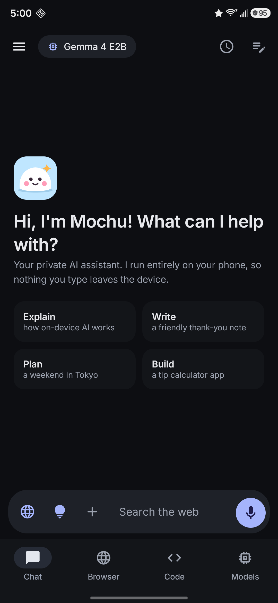
  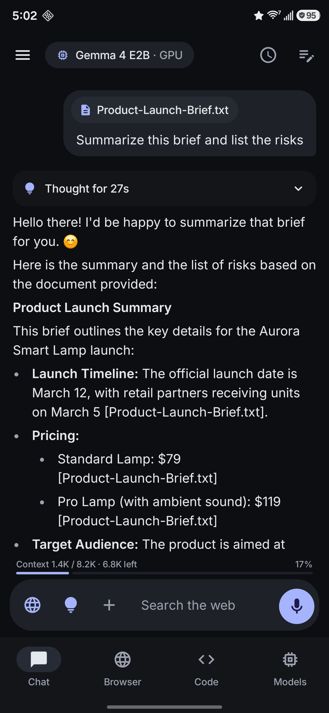
  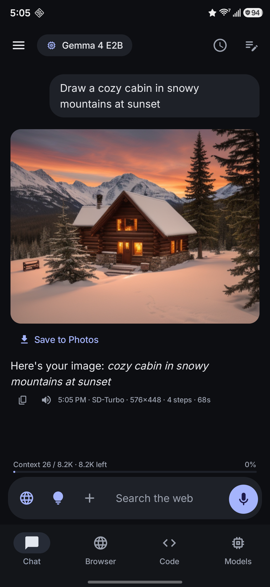

  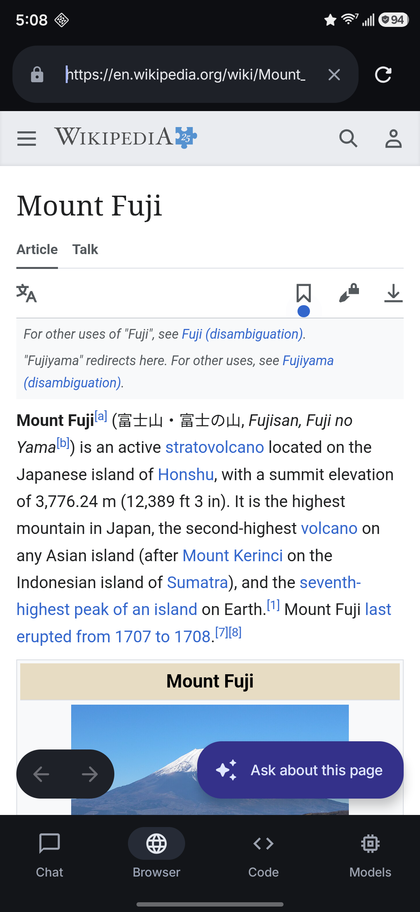
  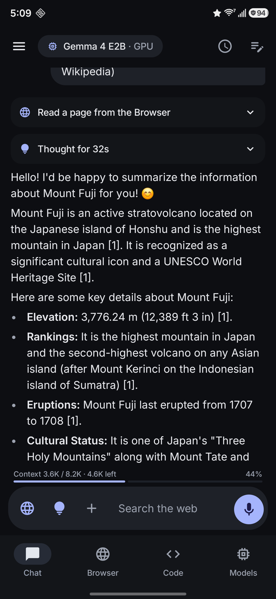
  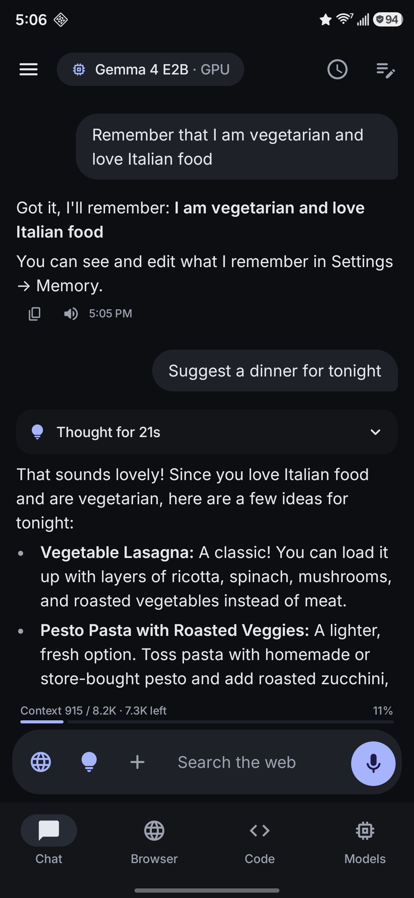

  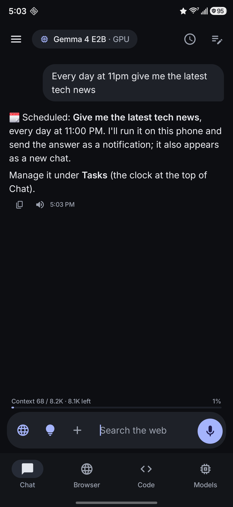
  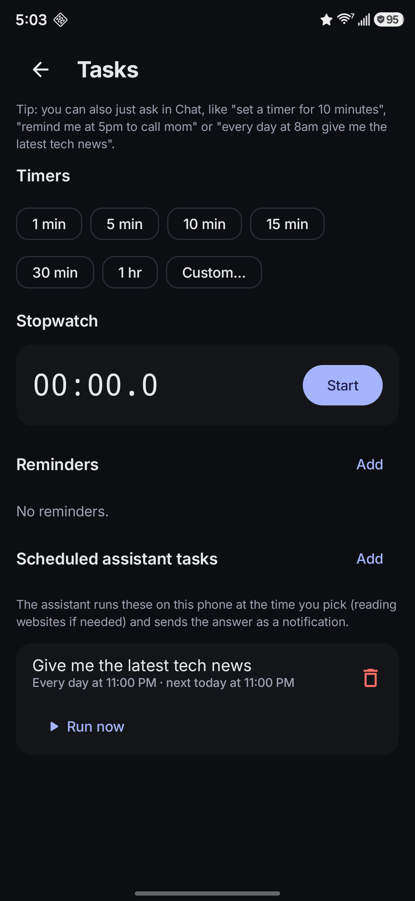
  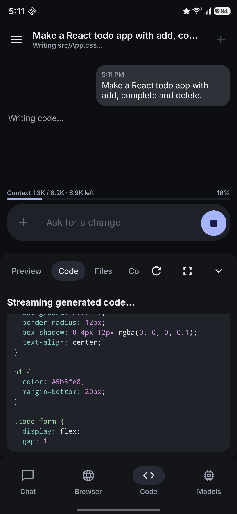

  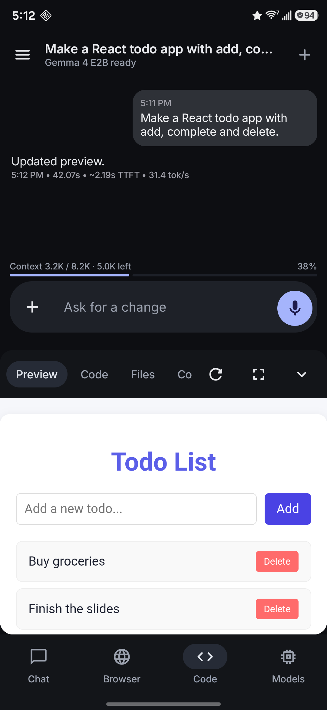
  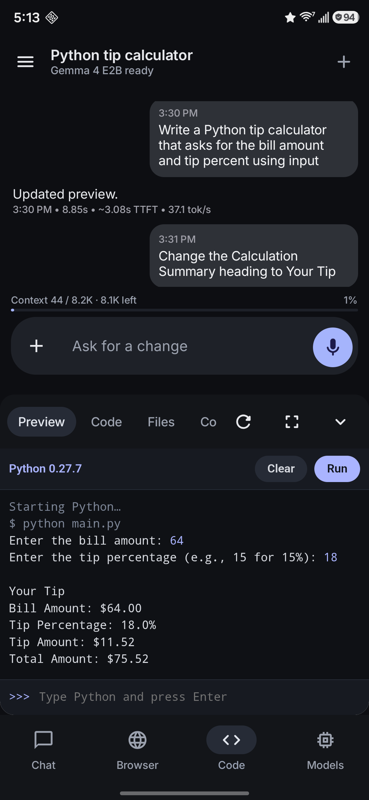

## Device Requirements

Minimum (app + basic usage):
- Android 12 or newer
- 6 GB RAM
- 4 GB free storage for app, workspace, and model files

Recommended (comfortable local model experience):
- Android 13 or newer
- 8 GB RAM or more
- Mid-range to flagship processor
- 4-6 GB free storage (depending on model size and project assets)

Notes:
- Larger `.litertlm` models need more RAM and storage.
- First model load can take longer; later runs are usually faster.

## Installing

1. Go to the GitHub **Releases** page: [latest release](https://github.com/nikunjsingh93/Mochu-Local-AI-Assistant/releases/latest)
2. Download the latest APK from the most recent release.
3. Open the APK on your Android device and install it.
4. Launch **Mochu AI**.

Upgrading from v1.0.6 or earlier: v1.0.7 and later are signed with a new key, so they install as a separate app next to the old one. Export any projects you want to keep from the old app (Files → Save ZIP), then uninstall it.

## Using the App

1. Open Mochu AI and download a model from the **Models** tab (the app recommends one for your phone), or import a `.litertlm` / `.gguf` file.
2. Chat with Mochu, or switch to **Code** to build a web, React or Python app from a prompt.
3. Use the globe for web search, **+** for photos and documents, the bulb for thinking, the mic to talk, and the clock for tasks and reminders.

## Security and Privacy Notes

- Generated project files stay inside app-private storage by default.
- External web navigation is restricted in preview flow.
- Imported files/models are handled locally on-device.

## Development

### Tech Stack

- Kotlin
- Jetpack Compose (Material 3)
- Android WebView
- LiteRT-LM Android runtime (`.litertlm` models, CPU/GPU/NPU)
- llama.cpp via JNI (`.gguf` models, CPU)
- ML Kit (OCR / labeling helpers)

### Requirements

- Android Studio (recent stable)
- JDK 17+
- Android SDK matching project config
- Android NDK 28.2 and CMake 3.31.6 (install from Android Studio's SDK Manager)
- The llama.cpp and stable-diffusion.cpp submodules: clone with `git clone --recurse-submodules`, or run `git submodule update --init` in an existing checkout

### Project Structure

- `app/src/main/java/com/nikunj/gemmabuilder/` - main app source
- `app/src/main/res/` - Android resources
- `app/src/main/AndroidManifest.xml` - app manifest
- `app/build.gradle.kts` - app module build config

### Build Notes

Current app version:

- `versionName`: `1.9.1`
- `applicationId`: `com.nikunj.mochu`

LiteRT-LM dependency is pinned in app Gradle config. If your environment needs it, you can switch to `latest.release`.

### Signing Release Builds

Release builds are signed when `keystore.properties` exists at the project root (it is gitignored). Copy `keystore.properties.example`, point `storeFile` at your keystore, and fill in the passwords. Without it, `assembleRelease` produces an unsigned APK. Keep the keystore and its password backed up outside the repo: every future update must be signed with the same key.

## License

This project is licensed under the MIT License. See [LICENSE](LICENSE) for details.
